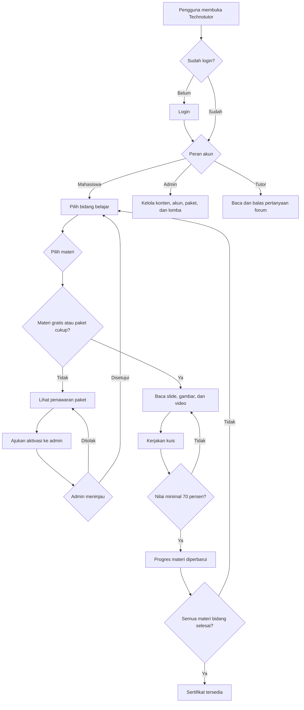
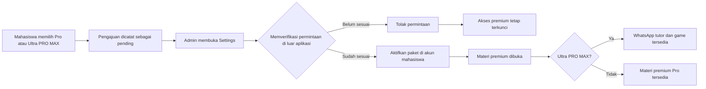
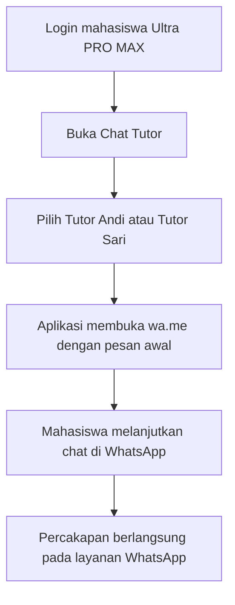
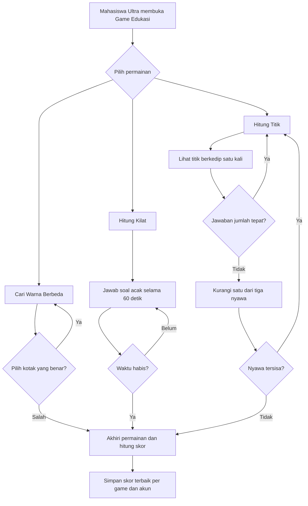

# Technotutor

Technotutor adalah aplikasi pembelajaran teknologi berbasis PHP native. Sistem ini menggabungkan materi ber-slide, gambar per slide, kuis, progres mahasiswa, sertifikat, katalog lomba, paket premium, forum dan kontak WhatsApp tutor, serta tiga game edukasi.

> **Status paket dan pembayaran:** harga pada halaman paket merupakan penawaran yang ditampilkan aplikasi. Aplikasi ini belum memakai payment gateway dan belum memproses pembayaran. Pengajuan paket diperiksa dan diaktifkan manual oleh admin. Akun demo Pro dan Ultra PRO MAX hanya untuk uji coba, bukan bukti transaksi atau langganan berbayar.

## Daftar isi

- [Ringkasan sistem](#ringkasan-sistem)
- [Peran dan hak akses](#peran-dan-hak-akses)
- [Paket dan harga](#paket-dan-harga)
- [Akun demo](#akun-demo)
- [Alur aplikasi](#alur-aplikasi)
- [Materi, slide, dan kuis](#materi-slide-dan-kuis)
- [Pengelolaan materi oleh admin](#pengelolaan-materi-oleh-admin)
- [Paket premium dan aktivasi manual](#paket-premium-dan-aktivasi-manual)
- [Chat tutor dan WhatsApp](#chat-tutor-dan-whatsapp)
- [Game edukasi](#game-edukasi)
- [Info lomba](#info-lomba)
- [Gambar dan berkas media](#gambar-dan-berkas-media)
- [Instalasi lokal](#instalasi-lokal)
- [Penyimpanan dan pembaruan data](#penyimpanan-dan-pembaruan-data)
- [Keamanan dan privasi](#keamanan-dan-privasi)
- [Struktur proyek](#struktur-proyek)
- [Pemecahan masalah](#pemecahan-masalah)

## Ringkasan sistem

| Bagian | Ringkasan |
| --- | --- |
| Teknologi | PHP native, HTML, CSS, JavaScript, dan penyimpanan JSON |
| Bidang | Software, Jaringan, Robotik & AI, dan Data Science |
| Jumlah materi | 200 materi: 50 pada setiap bidang |
| Materi gratis | 20 materi pada setiap bidang |
| Materi premium | 30 materi pada setiap bidang; 120 materi keseluruhan |
| Isi tiap materi | Minimal 8 slide, minimal dua paragraf per slide, dan 10 soal pilihan ganda |
| Media slide | Gambar khusus per materi dan nomor slide; foto galeri sebagai fallback |
| Paket | Gratis, Pro, dan Ultra PRO MAX |
| Tutor | Dua akun tutor untuk membalas forum; pelanggan Ultra juga dapat membuka chat WhatsApp tutor |
| Game Ultra | Cari Warna Berbeda, Hitung Kilat, dan Hitung Titik |
| Basis data | `data/data.json`; tidak membutuhkan MySQL |

## Peran dan hak akses

### Mahasiswa

- Membuka materi yang termasuk dalam paket aktif.
- Membaca slide, melihat gambar, dan membuka tautan YouTube yang tersedia.
- Mengerjakan kuis. Nilai kelulusan kuis adalah minimal 70%.
- Melihat progres per bidang dan sertifikat setelah menyelesaikan semua materi yang dapat diakses di bidang tersebut.
- Mengajukan aktivasi paket dari halaman **Paket Premium**.
- Pengguna Ultra PRO MAX dapat menggunakan kontak WhatsApp tutor dan tiga game edukasi.

### Admin

- Mengelola materi: membuat, mengedit, dan menghapus; mengatur bidang, tingkat kesulitan, deskripsi, slide, gambar, tautan YouTube, kuis, dan status premium.
- Mengelola katalog Info Lomba.
- Memproses pengajuan paket mahasiswa dan mengaktifkan atau menolak permintaan.
- Membaca dan membalas pertanyaan pada forum Tutor.
- Menambahkan akun melalui Settings dan mereset progres serta nilai kuis mahasiswa satu per satu.
- Admin dapat membuka materi untuk kebutuhan pengelolaan konten.

### Tutor

- Masuk menggunakan akun tutor.
- Membaca pertanyaan mahasiswa di forum dan mengirim balasan.
- Tutor demo tidak mendapatkan akses admin atau hak untuk mengubah materi maupun paket.

## Paket dan harga

Harga normal serta harga penawaran yang ditampilkan aplikasi:

| Paket | Harga normal | Harga penawaran | Diskon yang ditampilkan | Akses |
| --- | ---: | ---: | ---: | --- |
| Gratis | — | Gratis | — | 20 materi awal di masing-masing bidang |
| Pro | Rp129.000 | **Rp79.000** | **39%** | Seluruh 30 materi premium tambahan per bidang |
| Ultra PRO MAX | Rp249.000 | **Rp159.000** | **36%** | Semua akses Pro, forum Tutor, kontak WhatsApp dua tutor, dan tiga game edukasi |

Harga ditampilkan sebagai informasi penawaran di dalam aplikasi. Tidak ada checkout, payment gateway, bukti bayar, atau pemrosesan transaksi. Admin mengaktifkan paket secara manual setelah memverifikasi proses di luar aplikasi.

## Akun demo

Seluruh username dan password demo tercantum di [`userandpw.md`](./userandpw.md). Berikut ringkasannya:

| Peran / paket | Username | Password demo |
| --- | --- | --- |
| Admin | `admin1` | `admin123` |
| Admin | `admin2` | `admin123` |
| Mahasiswa Gratis | `mhs1` | `mhs123` |
| Mahasiswa Gratis | `mhs2` | `mhs123` |
| Mahasiswa Gratis | `mhs3` | `mhs123` |
| Mahasiswa Gratis | `mhs4` | `BelajarTekno4!26` |
| Mahasiswa Gratis | `mhs5` | `BelajarTekno5!26` |
| Mahasiswa Gratis | `mhs6` | `BelajarTekno6!26` |
| Tutor | `tutor1` | `TutorTekno1!26` |
| Tutor | `tutor2` | `TutorTekno2!26` |
| Mahasiswa demo Pro | `promhs` | `ProDemo!2026` |
| Mahasiswa demo Ultra PRO MAX | `ultramhs` | `UltraDemo!2026` |

Akun `promhs` dan `ultramhs` disediakan untuk memeriksa akses paket tanpa mengirim pengajuan atau mengubah akun mahasiswa lain. Kredensial tersebut adalah kredensial demo lokal; ganti sebelum aplikasi dipublikasikan atau digunakan bersama.

## Alur aplikasi

### Alur belajar dan akses materi



### Alur penawaran dan aktivasi paket



### Alur kontak Tutor melalui WhatsApp



Tautan membuka aplikasi atau situs WhatsApp; percakapan WhatsApp **tidak disimpan di Technotutor**. Forum tanya-jawab internal tetap tersedia sebagai kanal tambahan dan dapat dibalas oleh akun tutor.

### Alur game



## Materi, slide, dan kuis

- Empat bidang: **Software**, **Jaringan**, **Robotik & AI**, dan **Data Science**.
- Setiap bidang menyediakan 50 materi: 20 materi awal dan 30 materi premium.
- Setiap materi bawaan mempunyai delapan slide dan minimal 10 soal pilihan ganda.
- Setiap slide memuat judul dan uraian minimal dua paragraf. Admin dapat menambah, mengedit, menghapus, atau mengurutkan slide melalui teks slide di editor.
- Tautan YouTube boleh kosong. Jika tidak tersedia, tampilan materi menunjukkan `-`.
- Gambar materi dikelola pada panel gambar terpisah di editor.
- Kuis memiliki empat pilihan jawaban per soal. Nilai minimal 70% menandai materi selesai; mahasiswa dapat mengulang kuis.
- Data progres dan skor kuis disimpan per username mahasiswa. Paket mahasiswa demo Pro dan Ultra tidak mengubah progres akun lain.

## Pengelolaan materi oleh admin

1. Login menggunakan akun admin.
2. Pilih bidang pada navigasi, lalu pilih **Tambah Materi** atau buka materi dan pilih **Edit materi**.
3. Atur judul, bidang, tingkat kesulitan (1–5), dan centang **materi premium** jika ingin menguncinya untuk akun Gratis.
4. Edit isi setiap slide. Format satu baris per slide:

   ```text
   judul|paragraf pertama\n\nparagraf kedua||tautan YouTube opsional
   ```

   Gunakan `\n` untuk baris baru dan `\n\n` untuk memisahkan paragraf. Struktur kolom dipisahkan dengan `|`.

5. Edit kuis. Format satu baris per pertanyaan:

   ```text
   pertanyaan|pilihan A|pilihan B|pilihan C|pilihan D|indeks jawaban benar
   ```

   Indeks jawaban dimulai dari `0` hingga `3`.

6. Simpan materi. Materi memerlukan minimal delapan slide, dua paragraf per slide, dan minimal satu soal.
7. Untuk gambar, gunakan panel **Gambar per slide**: pilih berkas atau seret gambar ke dropzone. Berkas dapat diganti dan dihapus; penghapusan memakai fallback galeri.

Saat materi berpindah bidang, sistem menyalin gambar slide yang sudah ada ke folder bidang baru. Materi, soal, status premium, serta gambar semuanya tersimpan terpisah dari logika seed agar dapat diedit admin.

## Paket premium dan aktivasi manual

1. Mahasiswa memilih **Paket Premium**.
2. Mahasiswa mengajukan Pro atau Ultra PRO MAX. Untuk setiap akun hanya satu pengajuan yang dapat berstatus menunggu pada satu waktu.
3. Admin melihat pengajuan pada **Settings → Pengajuan Paket Premium**.
4. Admin memverifikasi permintaan/pembayaran melalui prosedur eksternal.
5. Admin memilih **Aktifkan paket** atau **Tolak**.
6. Jika disetujui, paket disimpan pada akun. Pro membuka 30 materi premium per bidang; Ultra PRO MAX membuka akses tersebut serta tutor WhatsApp dan game.

**Tidak ada integrasi pembayaran.** Tombol pengajuan bukan tombol bayar dan status pengajuan bukan bukti transaksi. Harga/diskon yang terlihat di demo merupakan label penawaran aplikasi.

## Chat tutor dan WhatsApp

Ultra PRO MAX menyediakan dua jalur untuk bertanya:

1. **WhatsApp langsung:** di halaman Chat Tutor pilih salah satu tombol kontak. Aplikasi membuat tautan `wa.me` dan pesan pembuka agar mahasiswa dapat melanjutkan percakapan di WhatsApp.
2. **Forum internal:** mahasiswa mengirim pertanyaan di halaman Chat Tutor; tutor `tutor1` atau `tutor2` masuk dan membalasnya. Forum disimpan dalam `data/data.json`.

| Tutor | Username forum | Nomor WhatsApp |
| --- | --- | --- |
| Tutor Andi | `tutor1` | **+62 895-1080-9179** |
| Tutor Sari | `tutor2` | **+62 821-1222-7425** |

Nomor tersebut diberikan untuk digunakan sebagai tautan kontak di aplikasi. Periksa kembali bahwa akun WhatsApp terkait aktif dan memang dikelola tutor yang bersangkutan sebelum peluncuran. WhatsApp adalah layanan eksternal; isi chat dan status pengiriman tidak tersedia di basis data Technotutor. Jangan kirim password atau data sensitif melalui chat.

## Game edukasi

Ketiga permainan hanya tersedia untuk mahasiswa Ultra PRO MAX:

- **Cari Warna Berbeda:** pilih kotak dengan warna yang berbeda. Jumlah kotak bertambah dan perbedaan warna makin halus. Satu pilihan salah mengakhiri permainan.
- **Hitung Kilat:** jawab operasi hitung acak dalam batas waktu 60 detik. Jawaban benar menambah skor dan membangkitkan soal berikutnya.
- **Hitung Titik:** perhatikan titik berkedip satu kali, lalu masukkan jumlahnya. Jawaban salah mengurangi satu nyawa dari tiga; permainan selesai ketika nyawa habis.

Skor terbaik disimpan per username dan nama permainan di JSON. Skor dari browser tidak digunakan sebagai bukti atau sertifikasi kemampuan.

## Info lomba

Katalog Info Lomba dapat menampilkan judul, kategori/bidang, penyelenggara, jadwal, deskripsi, poster, dan tautan sumber. Admin dapat menambah, mengedit, serta menghapus entri. Periksa tanggal dan URL resmi penyelenggara sebelum menerbitkan informasi. Poster opsional disimpan di `assets/img/competitions/`.

## Gambar dan berkas media

### Gambar slide materi

Struktur folder:

```text
assets/img/materials/
└── <bidang>/
    └── <id-materi>/
        ├── 1.jpg
        ├── 2.png
        └── 8.webp
```

- Folder bidang dan materi dibuat otomatis dari data materi.
- Nomor berkas menunjukkan nomor slide. Format unggah: JPG/JPEG, PNG, dan WebP.
- Batas unggah aplikasi: 8 MB; dimensi maksimal 6000 × 6000 piksel serta 20 megapiksel.
- Gunakan panel admin untuk unggah, drag-and-drop, ganti, atau hapus gambar.
- Jika gambar khusus slide belum ada, aplikasi memilih foto dari `assets/img/hero-gallery/`. Sediakan setidaknya satu foto di sana agar fallback dapat ditampilkan.
- Foto beranda berasal dari folder `assets/img/hero-gallery/` dan berganti otomatis jika tersedia lebih dari satu gambar.

### Folder media lain

```text
assets/img/
├── hero-gallery/     # Foto beranda dan fallback gambar slide
├── materials/        # Gambar khusus per bidang/materi/slide
└── competitions/     # Poster info lomba
```

## Instalasi lokal

### Persyaratan

- PHP 8.0+ (aplikasi dikembangkan dan divalidasi menggunakan PHP 8.2).
- Ekstensi PHP `json`, `session`, dan `fileinfo` aktif. `fileinfo` diperlukan untuk validasi unggahan gambar.
- Folder proyek dan subfolder `data/` serta `assets/img/` dapat ditulis oleh proses PHP.
- Laragon, XAMPP, atau web server PHP lain. MySQL, Composer, dan Node.js tidak diperlukan untuk aplikasi ini.

### Laragon

1. Tempatkan proyek di `C:\laragon\www\technotutor`.
2. Jalankan **Start All**.
3. Buka `http://localhost/technotutor` atau virtual host Laragon yang telah dikonfigurasi.
4. Login dengan akun demo di [`userandpw.md`](./userandpw.md).

### PHP development server

Dari root proyek:

```powershell
php -S 127.0.0.1:8000 -t .
```

Buka `http://127.0.0.1:8000`.

### Setelah instalasi

- Login sebagai admin dan ganti password demo.
- Verifikasi izin tulis `data/data.json` dan folder media.
- Tambahkan foto berlisensi sesuai kebutuhan ke `assets/img/hero-gallery/`.
- Uji login mahasiswa, admin, dan tutor serta seluruh alur paket.
- Sebelum penggunaan publik, gunakan HTTPS, atur kontrol akses berkas JSON, ganti kredensial, dan tetapkan kebijakan privasi serta pengelolaan kontak Tutor.

## Penyimpanan dan pembaruan data

Semua data aplikasi disimpan dalam `data/data.json`, termasuk:

| Kunci JSON | Isi |
| --- | --- |
| `users` | Akun, hash password, peran, dan paket mahasiswa |
| `mat` | Materi, slide, soal, bidang, level, dan status premium |
| `prog` | Status materi selesai serta nilai terbaik per mahasiswa |
| `competitions` | Informasi lomba |
| `plan_requests` | Status pengajuan paket dan riwayat keputusan admin |
| `tutor_forum` | Pertanyaan mahasiswa dan balasan forum |
| `game_scores` | Skor terbaik game per username |

Setiap bidang berisi 15 materi awal dan lima materi tambahan gratis yang didefinisikan di `config/seed_materials.php`, serta 30 materi premium per bidang di `config/premium_materials.php`. Saat aplikasi dimuat, migrasi seed menambahkan materi atau akun demo yang belum ada dan membuat folder gambar. Data yang sudah ada tidak dimaksudkan untuk diganti setiap kali aplikasi dibuka.

**Backup dan pemulihan:**

1. Salin `data/data.json` dan folder `assets/img/` ke cadangan sebelum pembaruan atau pemindahan.
2. Jangan menghapus `data/data.json` untuk “reset” biasa. Menghapusnya membuat data awal baru dan menghilangkan akun tambahan, progres, pengajuan, forum, skor, serta pengaturan konten tersimpan.
3. Untuk memulihkan, hentikan perubahan sementara lalu kembalikan salinan JSON dan media dari backup yang sama.
4. Gunakan tombol reset mahasiswa di Settings admin untuk menghapus progres dan nilai satu mahasiswa; tindakan tersebut tidak menghapus akun atau materi.

## Keamanan dan privasi

- Password akun disimpan sebagai hash menggunakan `password_hash`; dokumen demo berisi password awal untuk instalasi lokal.
- Batasi akses langsung ke `data/data.json`, misalnya dengan konfigurasi web server yang menolak permintaan HTTP untuk folder data. Jangan menyimpan file backup di folder publik.
- Gunakan HTTPS pada deployment publik. Server development PHP/Laragon lokal bukan konfigurasi produksi.
- Aksi pengajuan paket, review paket, reset progres, forum tutor, dan pencatatan skor menggunakan token CSRF.
- Uploader memeriksa tipe MIME, konten gambar, ukuran, dan dimensi. Tetap batasi izin tulis hanya pada folder yang dibutuhkan.
- Nama kontak dan nomor tutor ditampilkan ke pelanggan Ultra melalui tautan WhatsApp; cantumkan persetujuan pemilik nomor dan kebijakan privasi sebelum aplikasi dipublikasikan.
- Chat WhatsApp berlangsung di WhatsApp, tidak disimpan oleh aplikasi. Forum internal disimpan dalam file JSON lokal.
- Jangan menganggap pengajuan yang disetujui demo sebagai pembayaran sungguhan. Verifikasi transaksi dilakukan di luar aplikasi.
- Akun demo dan data contoh tidak dirancang untuk menjadi kredensial produksi. Ganti semua password, termasuk akun tutor, sebelum dibuka ke publik.

## Struktur proyek

```text
technotutor/
├── assets/
│   ├── css/
│   │   └── style.css
│   └── img/
│       ├── hero-gallery/
│       ├── materials/
│       └── competitions/
├── config/
│   ├── app.php                  # Bidang, akun tambahan, akun tutor, demo paket
│   ├── seed_materials.php       # Materi umum dan lima materi tambahan per bidang
│   └── premium_materials.php   # 120 materi premium
├── data/
│   └── data.json                # Penyimpanan JSON runtime
├── includes/
│   ├── actions.php              # Aksi POST, akses paket, forum, game, CRUD
│   ├── auth.php                 # Login, sesi, dan pembatasan halaman
│   ├── database.php             # Pembuatan data awal
│   └── functions.php            # Helper, migrasi, seed, progres, kuis
├── views/
│   ├── layout/                  # Header, navigasi, footer
│   ├── game.php                 # Logika antarmuka tiga game
│   ├── games.php                # Daftar game Ultra
│   ├── plans.php                # Penawaran dan pengajuan paket
│   ├── tutor.php                # WhatsApp dan forum tanya tutor
│   ├── edit.php                 # Editor materi dan gambar admin
│   └── ...                      # Materi, bidang, kuis, lomba, Settings
├── index.php                    # Front controller dan daftar route
├── README.md
└── userandpw.md                 # Kredensial demo lokal
```

## Pemecahan masalah

| Gejala | Pemeriksaan |
| --- | --- |
| Login gagal | Pastikan username/password sesuai [`userandpw.md`](./userandpw.md); cek bahwa migrasi data sempat berjalan. |
| Materi premium tidak terbuka | Periksa paket akun di `data/data.json`; Pro atau Ultra harus sudah aktif pada akun yang login. |
| Pengajuan tidak muncul untuk admin | Muat ulang Settings dan pastikan mahasiswa tidak memiliki pengajuan pending yang lain. |
| Gambar gagal diunggah | Pastikan `fileinfo` aktif, file JPG/PNG/WebP valid, ukuran maksimal 8 MB, dimensi sesuai batas, dan folder media dapat ditulis. |
| Gambar materi kosong | Pastikan folder bidang/ID/slide benar atau tambahkan fallback di `assets/img/hero-gallery/`. |
| Kontak WhatsApp tidak terbuka | Pastikan ponsel atau browser memiliki akses WhatsApp dan format nomor internasional pada kontak tutor masih aktif. |
| Perubahan data tidak tersimpan | Pastikan `data/data.json` dapat ditulis oleh PHP dan JSON tetap valid. Pulihkan backup bila file rusak. |
| Forum atau skor demo tidak muncul | Pastikan membuka aplikasi menggunakan sesi akun yang benar dan periksa kunci `tutor_forum` atau `game_scores` pada JSON. |
